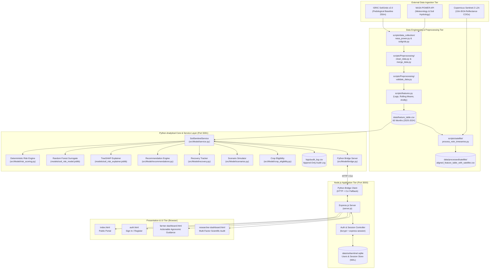

# SoilSentinel — System Architecture & Complete Data Flow Specification

**Project:** SoilSentinel — IBM Z Datathon 2026  
**Document:** System Architecture & Data Flow Reference  
**Path:** `docs/project_documentation/ARCHITECTURE_AND_DATA_FLOW.md`  
**Classification:** Technical Architecture Specification  
**Status:** Complete & Verified  

---

## 1. Architectural Philosophy & Design Principles

SoilSentinel was architected to bridge the divide between complex environmental earth observation data and practical, trustworthy agricultural decision-making. The system adheres to six foundational engineering principles:

1. **Decoupled Three-Tier Decision Engine:** Strict separation between deterministic agronomic heuristics (Tier 1), empirical statistical machine learning surrogate approximation (Tier 2), and independent physical soil degradation validation (Tier 3).
2. **Mainframe & Cross-Platform Portability:** Core decision algorithms, scoring equations, and inference runtimes rely purely on Python 3, NumPy, and Pandas with zero C-extension compile dependencies, ensuring native execution on IBM LinuxONE (s390x) and Windows/Linux x86_64.
3. **Defense-in-Depth Security & Zero-Trust Access Control:** Strict role-based authorization (`farmer` vs. `researcher`), cryptographic password hashing (bcrypt, cost factor 12), HTTP-only secure cookie sessions, SQL parameter binding, and reverse-proxy header hardening via Helmet.
4. **Append-Only Auditability:** Regulatory immutability where every assessment generates an immutable audit record containing PII-redacted feature snapshots, engine versions, and timestamped recommendation IDs.
5. **Bidirectional Process Communication:** Resilient integration between the Node.js Express web layer and the Python analytical backend via an automated child-process supervisor with an HTTP microservice architecture and CLI fallback.
6. **Graceful Degradation:** Transparent handling of missing temporal data (provisional scoring mode) and clear UI signaling when physical ground truth is unobserved (`PENDING_INDEPENDENT_GROUND_TRUTH`).

---

## 2. High-Level System Architecture Diagram



---

## 3. End-to-End Complete Data Flow

### Step 1: User Request & Route Dispatch
1. The user navigates to `http://localhost:3000/farmer-dashboard.html` or `http://localhost:3000/researcher-dashboard.html`.
2. The browser sends the request with the `soilsentinel.sid` cookie.
3. `server.js` verifies the session against the SQLite database via `requireRole('farmer')` or `requireRole('researcher')`.
4. If valid, the HTML dashboard shell is served. The client-side JavaScript immediately fires an asynchronous fetch request:
   ```http
   GET /api/assessment/dates HTTP/1.1
   ```

### Step 2: Date Discovery & Temporal Resolution
1. `server.js` routes the request to `callPythonBridge('/dates', 'dates', [])`.
2. The Node.js bridge client sends an HTTP GET request to `http://127.0.0.1:5001/dates`.
3. `src/Model/bridge.py` queries `SoilSentinelService.get_available_dates()`.
4. The service reads the chronologically sorted unique date values from the internal DataFrame (`2020-01` to `2024-12`).
5. Returns JSON response: `{ success: true, available_dates: [...], latest_date: "2024-12", count: 60 }`.
6. The frontend populates the month selection dropdown and triggers an assessment evaluation for the active month:
   ```http
   GET /api/assessment/evaluate?date=2024-12 HTTP/1.1
   ```

### Step 3: Analytical Orchestration & Calculation
When `GET /api/assessment/evaluate?date=YYYY-MM` is received:
1. `server.js` validates the date parameter format using regex `^\d{4}-\d{2}$`.
2. Invokes `callPythonBridge('/assessment?date=...', 'assessment', ['--date', date])`.
3. `src/Model/service.py::get_dashboard_payload` initiates parallel evaluations:
   - **Feature Retrieval:** Extracts the exact 1-row feature vector from `data/feature_table.csv` for the target month.
   - **Deterministic Risk Scoring:** `src/Model/risk_scoring.py` computes the composite hydro-thermal stress and baseline vulnerability score ($0\text{--}100$) across all 5 sub-scores with moisture buffering.
   - **Action Ranking:** `src/Model/recommendations.py` evaluates all sub-scores, filters actions by urgency (`CRITICAL`, `HIGH`, `MODERATE`, `MAINTENANCE`), and generates top-3 prioritized interventions.
   - **Longitudinal Recovery:** `src/Model/recovery.py` scans preceding records to compute Month-over-Month ($\Delta\text{MoM}$) and Year-over-Year ($\Delta\text{YoY}$) deltas and percentile ranking.
   - **Crop Suitability:** `src/Model/crop_eligibility.py` evaluates season (Kharif vs. Rabi), rainfall anomalies, and root-zone wetness to output eligible and restricted crops.
   - **Scenario Stress Testing:** `src/Model/scenarios.py` runs baseline versus hypothetical parameter shifts (`dry_spell`, `normal_climatology`, `heavy_rainfall`).
   - **ML Surrogate Inference:** `src/Model/model.py::predict_ml` feeds the frozen 14-feature vector into the Random Forest model (`models/soil_risk_model.joblib`) to estimate category probabilities.
   - **TreeSHAP Explainability:** `src/Model/model.py::explain_prediction` computes additive Shapley values, validates additivity ($\le 0.02$ tolerance), and extracts top driving features.
   - **Independent Degradation Assessment:** Attaches the formal specification block declaring physical validation status (`PENDING_INDEPENDENT_GROUND_TRUTH`).
   - **Audit Trail:** Appends an immutable record with a unique `ASM-YYYY-MM-timestamp` assessment ID to `logs/audit_log.csv`.

### Step 4: JSON Payload Delivery & Dashboard Rendering
1. The Python bridge serializes the consolidated payload to native UTF-8 JSON.
2. Node.js receives the stream, sets CORS and security headers, and sends it to the browser.
3. The dashboard JavaScript decodes the payload:
   - **Farmer UI:** Updates the large score badge, sets trajectory pills (`STABLE`, `RECOVERING`), populates the 3 prioritized action cards, updates crop tags, and binds slider controls.
   - **Researcher UI:** Populates the 5-indicator physical table, renders scenario cards, displays the 60-month historical series table, and reveals the regulatory audit metadata.

---

## 4. Module-by-Module Technical Specification

### 4.1 Analytical Backend Modules (`src/Model/`)

| Module File | Purpose & Responsibilities | Inputs | Outputs | Core Dependencies |
| :--- | :--- | :--- | :--- | :--- |
| [`risk_scoring.py`](file:///c:/Users/mohitkumar/Documents/Datathon/src/Model/risk_scoring.py) | Computes the deterministic *Seasonal Hydro-Thermal Stress & Baseline Vulnerability Index* ($0\text{--}100$). Implements moisture-buffering adjustments and bounds checking. | 1-row feature dictionary (`raw_record`) | `RiskScoringResult` (score, category, 5 indicator sub-scores, top drivers) | Pure Python, `math` |
| [`predict.py`](file:///c:/Users/mohitkumar/Documents/Datathon/src/Model/predict.py) | High-throughput batch scoring interface. Validates feature schemas and evaluates full DataFrames. | CSV path or `pd.DataFrame` | Scored DataFrame with `score` and `risk_category` | `pandas`, `numpy` |
| [`model.py`](file:///c:/Users/mohitkumar/Documents/Datathon/src/Model/model.py) | Loads trained surrogate artifacts, executes ML inference, computes TreeSHAP explanations, and validates mathematical additivity. | 14-feature vector, model binary, explainer binary | `ml_prediction` and `ml_explanation` dictionaries | `joblib`, `scikit-learn`, `shap`, `pandas` |
| [`recommendations.py`](file:///c:/Users/mohitkumar/Documents/Datathon/src/Model/recommendations.py) | Translates numerical indicator stress into agronomically ranked action plans. Classifies urgency and impact. | `RiskScoringResult`, raw feature record | `RankedRecommendationPlan` (top 3 actions, full 5 actions, primary stressor) | Pure Python |
| [`scenarios.py`](file:///c:/Users/mohitkumar/Documents/Datathon/src/Model/scenarios.py) | Simulates hypothetical weather stress (rainfall, temperature, horizon) against baseline farm state. | Baseline record, scenario parameters | `BaselineScenarioComparisonReport` (delta scores, category shifts) | Pure Python |
| [`recovery.py`](file:///c:/Users/mohitkumar/Documents/Datathon/src/Model/recovery.py) | Longitudinal trajectory analysis across 60 monthly steps. Computes MoM/YoY deltas and historical percentiles. | Scored DataFrame, target date string | `RecoveryAssessment` (trajectory status, deltas, historical mean/max) | `pandas`, `numpy` |
| [`crop_eligibility.py`](file:///c:/Users/mohitkumar/Documents/Datathon/src/Model/crop_eligibility.py) | Agronomic crop recommendation eligibility rules. Flags restricted crops under drought or extreme heat. | `RiskScoringResult`, date string | `CropEligibilityResult` (eligible crops, restricted crops, withhold reasons) | Pure Python |
| [`audit_log.py`](file:///c:/Users/mohitkumar/Documents/Datathon/src/Model/audit_log.py) | Regulatory audit logging engine. Appends immutable records with PII redaction and cryptographic tracking. | Prediction record, assessment ID, rec IDs | Appends row to `logs/audit_log.csv` | `csv`, `datetime`, `pathlib` |
| [`service.py`](file:///c:/Users/mohitkumar/Documents/Datathon/src/Model/service.py) | Central orchestrator. Merges all modular outputs into a single JSON-serializable dashboard payload. | Target date `YYYY-MM` | Consolidated dashboard payload dictionary | All `src/Model/` modules |
| [`bridge.py`](file:///c:/Users/mohitkumar/Documents/Datathon/src/Model/bridge.py) | Inter-process communication adapter. Provides HTTP microservice (`HTTPServer`) and CLI execution modes. | HTTP GET/POST or CLI arguments | Native JSON responses | `http.server`, `json`, `argparse` |

---

### 4.2 Data Engineering & Satellite Scripts (`scripts/`)

| Script Path | Purpose & Technical Function | Primary Inputs | Generated Outputs |
| :--- | :--- | :--- | :--- |
| `scripts/data_collection/nasa_power.py` | Automated ingestion client querying NASA POWER Agroclimatology API for daily meteorology, aggregating to monthly averages. | API endpoints, latitude, longitude, year range | `data/raw/climate/nasa_power_monthly_*.json` |
| `scripts/data_collection/soilgrids.py` | Streams pedological GeoTIFF layers from ISRIC SoilGrids v2.0 over HTTP VRT (`/vsicurl/`). Performs radial search to bypass urban masked pixels. | Goode Homolosine VRT coordinates | `data/raw/soil/soilgrids_raw_metadata.json` |
| `scripts/Preprocessing/clean_data.py` | Data normalization: standardizes datetime formats, strips whitespace, converts numeric columns, audits bounds. | Raw JSON payloads | Cleaned CSV files in `data/processed/` |
| `scripts/Preprocessing/merge_data.py` | Combines dynamic climate series with depth-weighted static soil baseline properties (0–30 cm). | Cleaned climate and soil CSVs | `data/processed/combined_features.csv` |
| `scripts/Preprocessing/validate_data.py` | Schema assertion engine verifying physical boundaries, column presence, and exact NaN boundary positions. | Merged feature tables | Data validation report & boolean assertions |
| `scripts/features.py` | Feature engineering pipeline generating 1-month lags, 3-month/6-month rolling averages, aridity index, and trigonometric seasonal encodings (`month_sin`, `month_cos`). | `combined_features.csv` | Master `data/feature_table.csv` (60 rows $\times$ 53 cols) |
| `scripts/satellite/acquire_sentinel2_timeseries.py` | Programmatic acquisition of cloud-masked Sentinel-2 L2A BOA multispectral bands (B4 Red, B8 NIR, SCL). | AWS Element84 STAC / COG URLs | `data/raw/satellite/*.tif` GeoTIFFs |
| `scripts/satellite/process_ndvi_timeseries.py` | Calibrated floating-point NDVI calculation with Scene Classification Layer (SCL) cloud/shadow masking. | Raw spectral GeoTIFF arrays | `data/processed/satellite/sentinel2_ndvi_monthly_timeseries.csv` |
| `scripts/satellite/align_satellite_to_feature_table.py` | Chronological merge linking Sentinel-2 NDVI observations to the master feature table. | `feature_table.csv` & satellite CSV | `data/processed/satellite/aligned_feature_table_with_satellite.csv` (60 rows $\times$ 66 cols) |

---

### 4.3 Web Server & Frontend Architecture (`server.js`, HTML/CSS)

| File | Purpose | Security & Architectural Controls |
| :--- | :--- | :--- |
| [`server.js`](file:///c:/Users/mohitkumar/Documents/Datathon/server.js) | Main application server (Express.js on port 3000). | Helmet HTTP header hardening, rate limiting (20 attempts / 15 min), secure session management, SQLite WAL persistence, child process supervisor. |
| [`auth.html`](file:///c:/Users/mohitkumar/Documents/Datathon/auth.html) | Universal authentication interface. | Asynchronous fetch submission, client-side validation, role toggle (`farmer` vs. `researcher`), CSRF-resistant cookie handling. |
| [`index.html`](file:///c:/Users/mohitkumar/Documents/Datathon/index.html) | Public platform overview and mission portal. | Responsive landing page, architecture highlights, agronomic explanations, live navigation links. |
| [`farmer-dashboard.html`](file:///c:/Users/mohitkumar/Documents/Datathon/farmer-dashboard.html) | Farmer-facing actionable dashboard. | Clean executive card layout, traffic-light risk categorization, plain-English action recommendations, interactive slider simulation. |
| [`researcher-dashboard.html`](file:///c:/Users/mohitkumar/Documents/Datathon/researcher-dashboard.html) | Scientific research and regulatory audit dashboard. | Multi-indicator numerical table, 60-month historical trend table, scenario comparison cards, regulatory audit record viewer. |
| [`styles.css`](file:///c:/Users/mohitkumar/Documents/Datathon/styles.css) | Master stylesheet. | Curated HSL color design system, mobile-responsive grid, glassmorphic card overlays, animated state transitions. |

---

## 5. Inter-Process Communication & Failure Recovery Protocol

`server.js` communicates with the Python core through a dual-channel adapter:

```
[Incoming Web Request] 
         │
         ▼
[Express Route Handler] 
         │
         ▼
[callPythonBridge()]
         │
         ├───► Try 1: HTTP Request to http://127.0.0.1:5001 (Timeout: 3500ms)
         │        │
         │        ├───► Success (200 OK): Parse JSON & Return to Client
         │        │
         │        └───► Failure (ECONNREFUSED / Timeout / Bridge Crash)
         │                 │
         │                 ▼
         └───────────► Try 2: Direct CLI Execution Fallback
                                  │
                                  ├──► `python -m src.Model.bridge assessment --date YYYY-MM`
                                  │
                                  ├──► Success: Parse STDOUT JSON & Return
                                  │
                                  └──► Failure: Return Formatted HTTP 500 JSON Error
```

This guarantees zero single-point-of-failure: if the Python HTTP background daemon is interrupted or busy, the server automatically executes the CLI fallback seamlessly without dropping user requests.
