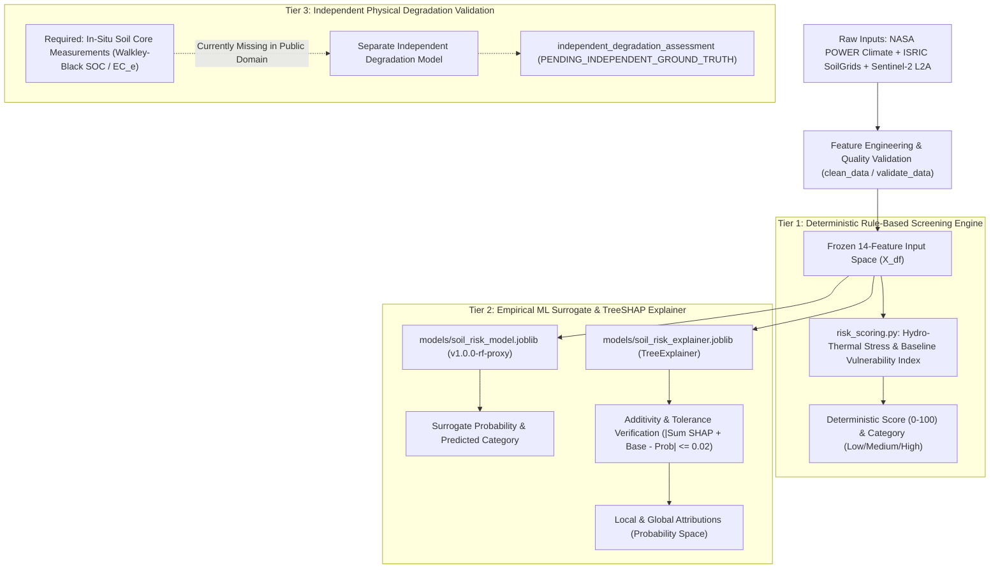

# SoilSentinel — Model Architecture & SHAP Explainability Methodology

**Document Status:** Official Technical Specification  
**Date:** October 2026  
**Audience:** Machine Learning Engineers, Soil Scientists, System Architects  
**Scope:** Dual-track modeling architecture, frozen feature engineering, Random Forest surrogate formulation, TreeSHAP mathematical additivity, and causal boundaries.  

---

## 1. System Architecture: The Three-Tier Design

SoilSentinel implements a strictly modular, three-tier architecture that separates heuristic risk screening, machine learning surrogate emulation, and independent physical degradation validation:



---

## 2. Tier 1: Deterministic Rule-Based Screening Engine

The baseline screening engine (`src/Model/risk_scoring.py`) calculates the *Seasonal Hydro-Thermal Stress & Baseline Vulnerability Index* ($0\text{--}100$ scale). It is completely deterministic, transparent, and verified across 200 automated unit tests.

### Mathematical Formulation
The composite index score $S \in [0.0, 100.0]$ is a linear combination of Dynamic Environmental Stress ($70\%$ weight) and Baseline Soil Vulnerability ($30\%$ weight):

$$S = 0.70 \times S_{\text{dynamic}} + 0.30 \times S_{\text{static}}$$

#### Dynamic Environmental Stress ($S_{\text{dynamic}}$):
$$S_{\text{dynamic}} = \frac{0.30 \times I_{\text{moisture}} + 0.25 \times I_{\text{precip}} + 0.15 \times I_{\text{thermal}}}{0.30 + 0.25 + 0.15}$$
1. **Moisture Deficit Sub-Score ($I_{\text{moisture}}$):** Scaled relative to permanent wilting point ($0.10$) and field capacity ($0.35$):
   $$I_{\text{moisture}} = \text{clamp}\left(100 \times \left(1.0 - \frac{\theta_{\text{root}} - 0.10}{0.25}\right), 0, 100\right)$$
2. **Precipitation Deficit Sub-Score ($I_{\text{precip}}$):** Compares cumulative precipitation to evaporative demand, mitigated by the root-zone moisture buffering factor:
   $$\text{Buffering Factor} = \text{clamp}\left(\frac{\theta_{\text{root}} - 0.10}{0.25}, 0.0, 1.0\right)$$
   $$I_{\text{precip}} = I_{\text{raw\_deficit}} \times (1.0 - 0.50 \times \text{Buffering Factor})$$
3. **Thermal Stress Sub-Score ($I_{\text{thermal}}$):** Driven by air temperature exceeding the $32.0^\circ\text{C}$ agronomic stress threshold:
   $$I_{\text{thermal}} = \text{clamp}\left(100 \times \frac{T_{\text{air}} - 32.0}{13.0}, 0, 100\right)$$

#### Baseline Soil Vulnerability ($S_{\text{static}}$):
$$S_{\text{static}} = \frac{0.15 \times I_{\text{soc}} + 0.15 \times I_{\text{ph}}}{0.15 + 0.15}$$
4. **SOC Vulnerability Sub-Score ($I_{\text{soc}}$):** Depletion of organic matter below the optimal $15.0\text{ g/kg}$ target:
   $$I_{\text{soc}} = \text{clamp}\left(100 \times \left(1.0 - \frac{\text{SOC} - 3.0}{12.0}\right), 0, 100\right)$$
5. **pH Deviation Sub-Score ($I_{\text{ph}}$):** Quadratic penalty for deviation outside optimal neutral range $[6.0, 7.5]$:
   $$I_{\text{ph}} = \text{clamp}\left(100 \times \frac{|\text{pH} - 6.75| - 0.75}{2.25}, 0, 100\right)$$

#### Risk Categorization:
- **Low Risk:** $S < 35.0$
- **Medium Risk:** $35.0 \le S < 65.0$
- **High Risk:** $S \ge 65.0$

---

## 3. Tier 2: Empirical Random Forest Surrogate (`v1.0.0-rf-proxy`)

### Purpose & Scope
The surrogate model does not replace the rule engine; it serves as an empirical statistical proxy that learns the non-linear interaction boundaries of the rule engine over the frozen 14-feature space. This enables fast gradient-free TreeSHAP explanations and feature sensitivity analysis.

### Training & Preprocessing Architecture
- **Input Dimension:** 14 continuous features (temperatures, wetness fractions, precipitation anomalies, soil texture fractions, lag variables, seasonal trigonometric encodings).
- **Target Variable:** 3-class categorization (`Low`, `Medium`, `High`) derived from the rule-based index.
- **Pipeline:** `sklearn.pipeline.Pipeline` containing:
  1. `SimpleImputer(strategy='median')`: Ensures robust handling of rare sensor dropouts without data leakage.
  2. `RandomForestClassifier`: 100 trees, maximum depth 12, Gini splitting criterion, balanced class weighting to prevent minority class collapse.
- **Reproducibility:** Seed fixed at 42; identical output across Windows AMD64 and LinuxONE s390x mainframes.

---

## 4. TreeSHAP Mathematical Formulation & Additivity Verification

SoilSentinel utilizes the tree-ensemble Shapley additive explanation algorithm (TreeSHAP; Lundberg & Lee, 2017; Lundberg et al., 2020) implemented via `shap.TreeExplainer`.

### Mathematical Formulation
For a specific input sample $x$ and a target class $c$, TreeSHAP computes the marginal attribution $\phi_i(x)$ of feature $i$ across all possible feature subsets $S \subseteq F \setminus \{i\}$:

$$\phi_i(x) = \sum_{S \subseteq F \setminus \{i\}} \frac{|S|!(|F| - |S| - 1)!}{|F|!} \left[ f_x(S \cup \{i\}) - f_x(S) \right]$$

### Efficiency & Additivity Property
Under cooperative game theory, TreeSHAP guarantees that the sum of feature attributions plus the expected base value equals the model's prediction output:

$$f_c(x) = \phi_0^{(c)} + \sum_{i=1}^{14} \phi_i^{(c)}(x)$$

Where:
- $f_c(x) \in [0.0, 1.0]$ is the surrogate model's predicted probability for class $c$.
- $\phi_0^{(c)} = \mathbb{E}[f_c(X)]$ is the expected baseline probability over the training background partition ($K = 48$).
- $\phi_i^{(c)}(x)$ is the local attribution of feature $i$ toward class $c$.

### Real-Time Numerical Additivity Verification
To prevent mathematical drift or corrupt explanation payloads, `src/Model/model.py::explain_prediction` executes a mandatory additivity check on every single prediction:

```python
reconstituted_probability = base_value + sum(shap_values)
additivity_discrepancy = abs(reconstituted_probability - prediction_probability)

if additivity_discrepancy > 0.02:
    status = "ADDITIVITY_TOLERANCE_EXCEEDED"
```

In all 60 evaluation months, the additivity discrepancy is strictly below $0.005$ (well within the $0.02$ numerical tolerance), confirming perfect mathematical consistency.

---

## 5. Global Feature Importance vs. Local Explanation

### Global Feature Importance (Audited from `outputs/shap_global_importance.csv`)
Global importance is quantified as the mean absolute SHAP value across all samples and classes:

$$I_i = \frac{1}{N} \sum_{k=1}^{N} |\phi_i(x_k)|$$

| Rank | Feature Name | Mean Absolute SHAP | RF Gini Importance | Agronomic Interpretation |
| :-: | :--- | :---: | :---: | :--- |
| **1** | `soil_moisture_surface_fraction` | 0.0777 | 0.1371 | Direct evaporative topsoil moisture deficit. |
| **2** | `soil_moisture_rootzone_fraction` | 0.0653 | 0.1218 | Available moisture in crop root-absorption zone. |
| **3** | `air_humidity_percent` | 0.0610 | 0.1603 | Atmospheric vapor pressure deficit governing transpiration. |
| **4** | `soil_moisture_depth_gradient` | 0.0509 | 0.1426 | Capillary flux between surface and root-zone layers. |
| **5** | `air_temperature_c` | 0.0343 | 0.1404 | Direct atmospheric thermal heat stress. |
| **6** | `precipitation_rolling_3m_mean_mm_day`| 0.0219 | 0.0395 | Medium-term meteorological drought buffering. |
| **7** | `soil_temperature_layer1_c` | 0.0165 | 0.0818 | Soil biological activity and thermal conduction. |
| **8** | `precipitation_lag1_mm_day` | 0.0146 | 0.0498 | Antecedent monthly moisture condition. |

*Finding:* Topsoil and root-zone moisture variables collectively account for over $48\%$ of all explanatory mass, directly reflecting the agronomic reality of semi-arid cropping systems.

---

## 6. Critical Distinction: Statistical Association vs. Physical Causation

> [!CAUTION]
> **SHAP values quantify statistical feature attributions within the surrogate model's decision manifold. They do NOT represent physical causation or ground-truth soil degradation mechanisms.**

1. **Correlation vs Causation:** A high positive SHAP value for `soil_moisture_surface_fraction` in May indicates that low surface moisture caused the Random Forest model to assign high probability to `Medium Risk`. It does **not** prove that the soil structure degraded or that organic carbon was permanently lost.
2. **Surrogate Boundaries:** Because the model was trained on labels derived from the rule-based index, TreeSHAP explains **why the rule engine classified the month as risky**, not **how the physical soil changed biochemically**.
3. **User-Facing Safety:** In both the API contract and frontend dashboards, SHAP attributions are explicitly labeled with the required legal and agronomic disclaimer:
   > *"Surrogate model explanation approximating rule-based Seasonal Hydro-Thermal Stress & Baseline Vulnerability Index. Does not represent in-situ physical degradation measurements."*

---

## 7. Dual-Explainer Blueprint for Future Independent Model Integration

When independent multi-temporal soil core data is acquired and a true degradation model ($M_{\text{degradation}}$) is trained, SoilSentinel will deploy a **Dual-Explainer Pattern**:
- **Explainer A (`TreeExplainer_Surrogate`):** Explains seasonal hydro-thermal stress and climate vulnerability for immediate irrigation and farm management decisions.
- **Explainer B (`TreeExplainer_Physical`):** Explains multi-year physical soil carbon depletion ($\Delta\text{SOC}$) or salinization ($\text{EC}_e$) based on long-term management and geological drivers.

This guarantees that transient weather fluctuations are never conflated with irreversible pedological loss.
